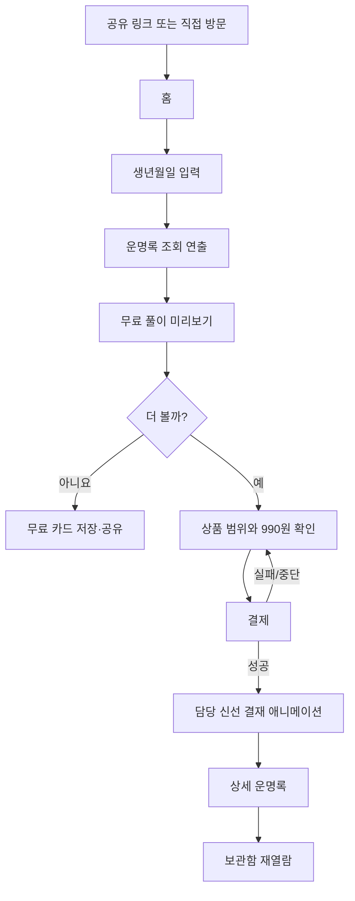

# 00. 서비스 기획 및 브랜드 정의

> **로컬 시제품 범위 확정 (2026-10-28):** 종합·애정·직업·재물·올해·대운·궁합 7개 상품을 각각 선택해 소개 → 입력 → 무료 미리보기 → 0원 모의 구매 → 상품별 다섯 영역 상세 결과 → 보관함을 체험한다. 결과 상단의 반원 게이지는 다섯 해석 방향을 보여주는 고정 샘플이며 점수·성공 확률이 아니다. 올해는 2026년 예시, 대운은 가상 구간 A·B·C로 실제 나이·연운·대운표를 계산하지 않는다. 한국 출생, 양력/음력/윤달/시간 모름을 표현하고 성별은 수집하지 않는다. 모든 계산·결과·구매는 개발용 샘플이다. 아래 장기 제품 구상과 구분하며 [시제품 안내](11-local-prototype.md)를 현재 구현의 기준으로 사용한다.

## 0. 문서 메타

- 제품명: **천명록 (天命錄)**
- 콘셉트: **천계 운명관리소**에서 견습 신선 **운몽이**가 사람들의 운명록을 찾아 읽어 주는 모바일 사주 웹앱
- 카테고리: 오락·자기성찰형 사주 풀이 콘텐츠
- 상태: v1.0 초안 (2026-10-27)
- 가격 가설: 대표 단품 **990원** (과금안 확정 전, 총액 표기 기준)
- 원본 캐릭터: `../assets/reference/woonmong_original_landing.png`

## 1. 비전

> **"당신의 오늘도, 조금은 더 빛나길."**

어렵고 무겁게 느껴지는 명리학을 귀엽고 정서적으로 안전한 이야기 경험으로 전달한다. 결과를 보는 순간이 '무서운 예언'이 아닌 '나를 이해하는 한 페이지'처럼 느껴지게 한다.

## 2. 핵심 차별점

1. **사주를 서류 경험으로 재해석** — 사주 입력 → 천계 서고 검색 → 무료 열람 → 담당 신선 **결재** → 상세 운명록 공개.
2. **단일 캐릭터 중심 스토리텔링** — 친근한 초보 직원 운몽이의 동일한 얼굴·목소리·애니메이션.
3. **990원 콘텐츠의 명확한 가치** — 결제 전 풀이 분량/목차/다루는 질문을 명시. 추가 결제는 유용한 후속 질문에 한정.
4. **SNS 공유 가능한 발령장** — 천계 부서/역할 결과 카드 + 친구와 합동결재서.
5. **재방문 동기** — 무료 오늘 운세, 이미 결제한 운명록 재열람, 새 콘텐츠 업데이트.

## 3. 주요 타깃 및 JTBD

- 1차: 모바일에서 1~3분 내 사주·연애운을 가볍게 보고 싶은 20~30대 사용자.
- 2차: 친구/연인과 성격·궁합 콘텐츠를 공유하는 사용자.
- JTBD A: '나를 설명하는 짧고 재미있는 해석을 보고 싶다.'
- JTBD B: '990원이라면 무엇을 얻게 되는지 확인하고 결제하고 싶다.'
- JTBD C: '친구에게 보낼만한 귀여운 결과 카드를 얻고 싶다.'

타깃 연령은 초기 가설이며 검증 후 변경한다.

## 4. 세계관

| 요소 | 정의 | 사용자에게 보이는 표현 |
| --- | --- | --- |
| 천계 운명관리소 | 모든 사람이 가진 운명 기록을 관리하는 장소 | 서비스 전체 배경 |
| 운명록 | 개인 생년월일을 기반으로 구성한 해석 기록 | 사주 결과 |
| 운몽이 | 갓 배치된 견습 신선 | 사용자를 안내하는 메인 캐릭터 |
| 몽실이 | 운몽이를 돕는 동그란 구름 친구 | 로딩/빈 상태/마스코트 서브 |
| 담당 신선 | 분야별 해석을 승인하는 세계관상 선배 | 연애/재물/진로 카테고리 |
| 결재 도장 | 상세 기록이 열렸다는 시각적 연출 | 실제 결제 성공 이후만 노출 |
| 천계 발령장 | 사용자의 유형을 재미있게 표현한 카드 | 무료 바이럴 콘텐츠 |

**세계관 경계:** 운몽이가 실제 초자연적 진실, 미래를 확정적으로 안다고 주장하지 않는다. 전문가가 직접 확인하지 않았다면 '담당 신선'은 상품의 캐릭터 연출일 뿐 실제 인적 검수자로 오인시키지 않는다.

## 5. 브랜드 음성

- 성격: 다정함 50% + 서투르지만 성실함 30% + 동양 판타지 20%.
- 1인칭: '저', '제가'; 호칭: 기본 '당신'보다 'OO님의'를 선호(이름이 없으면 '당신의').
- 종결: `~요`, `~볼까요?`, `~왔어요!`를 중심으로.
- 금지: 심판/저주/망함/곧 불행이 찾아온다 등 공포 조장, 과도한 애교, 결과를 증명된 사실처럼 표현.
- 대표 문구: '제가 볼 수 있는 건 여기까지예요. 더 자세한 내용은 담당 신선님께 여쭤볼게요!'
- 서비스 슬로건: '하늘 어딘가에, 이미 기록된 당신의 이야기.' (브랜드 카피이며 실제 사전 결정된 운명을 주장하는 설명은 아님)

## 현재 로컬 상품별 결과 구성

| 상품 | 다섯 상세 영역 |
| --- | --- |
| 종합 | 기질·관계·일·돈 관리·실천 |
| 애정 | 관계 성향·감정 표현·소통·관계 유지·실천 |
| 직업 | 일하는 방식·강점·협업·업무 환경·진로 점검 |
| 재물 | 돈을 대하는 태도·소비·관리·급한 결정 점검·실천 |
| 올해 | 연간 주제·1분기·2분기·3분기·4분기 (2026년 예시) |
| 대운 | 원국과 운·가상 구간 A·B·C·전환기 점검 |
| 궁합 | 두 사람의 성향·소통·공통점과 차이·갈등 조율·실천 |

각 상품의 미리보기·본문·목차는 고유하게 구성한다. 궁합은 두 사람의 시간 미상을 각각 처리하고 정보 입력 동의를 받는다. 원문은 저장·전송하지 않는다. 실제 판매용 내용·정확성·가격 확정과 구분한다.

## 6. 실제 출시 단계의 상품·기능 가설

| 구분 | MVP | Phase 2 | Phase 3 |
| --- | --- | --- | --- |
| 무료 성향 미리보기 | O | 개선 | 개선 |
| 종합 사주 990원 | O | 개선 | 개선 |
| 연애운 990원 | 선택적(권장 P2) | O | 개선 |
| 올해 운세 990원 | 선택적(권장 P2) | O | 개선 |
| 무료 오늘 운세 | O (간단 버전) | 개인화 | 개선 |
| 보관함/구매 복원 | O (결제 필수) | 개선 | 개선 |
| 천계 발령장 | P2 권장 | O | 개선 |
| 친구 합동결재 | - | O | 개선 |
| AI 자유 상담 | - | 검토 | 조건부 출시 |
| 재물/직업/궁합 상품 | - | 검토 | O |

실제 유료 출시의 최소 상품은 **종합 사주 990원 하나부터 검증**하는 가설이다. 로컬 7개 상품 체험과 구분하며, 실제 판매 범위·가격은 결제 시스템·복원·품질 검증 후 확정한다.

## 7. 핵심 사용자 여정

## 8. 사업 및 신뢰 원칙

- 웹에 표시하는 리뷰·이용 건수는 검증된 실제 데이터만.
- 무료와 유료의 경계가 명확해야 하며, 숨긴 내용을 보여주기 위해 과도한 불안 문구를 쓰지 않는다.
- 모든 유료 상품에 **최종 결제액, 제공 범위, 결과 접근 가능 기간/조건, 환불/청약철회 안내**를 명시.
- 이름/생년월일/태어난 시간/계정/결제 식별자 등의 취급은 별도 개인정보처리방침·보안 설계에 근거.
- '정확하다', '100% 맞다', '몇 월에 반드시 연애한다' 등 검증 불가능한 확정 표현을 지양.
- 990원 원가(LLM·결제수수료·세금·인프라·환불)를 반드시 산출한 후 정식 가격 확정.

## 9. 선결정/미결정

**확정:** Next.js 웹앱, 루트 DESIGN.md 디자인 기준, 모바일 전용, 하늘색 동양 판타지, 운몽이 원본 외형 유지, 친근한 UX 라이팅, 990원 중심 상품 전략.

**미결정:** 정확한 법적 사업자/PG, 캐릭터·브랜드 상표 검토, 사주 계산 구현체, 로그인 정책, 무료 풀이 분량, 콘텐츠 생성 비용, 발령장 유형 개수. `09` 문서에 기록 후 출시 전 승인.

서비스 출시를 위한 전체 결정 목록: [10-launch-decisions.md](10-launch-decisions.md).
