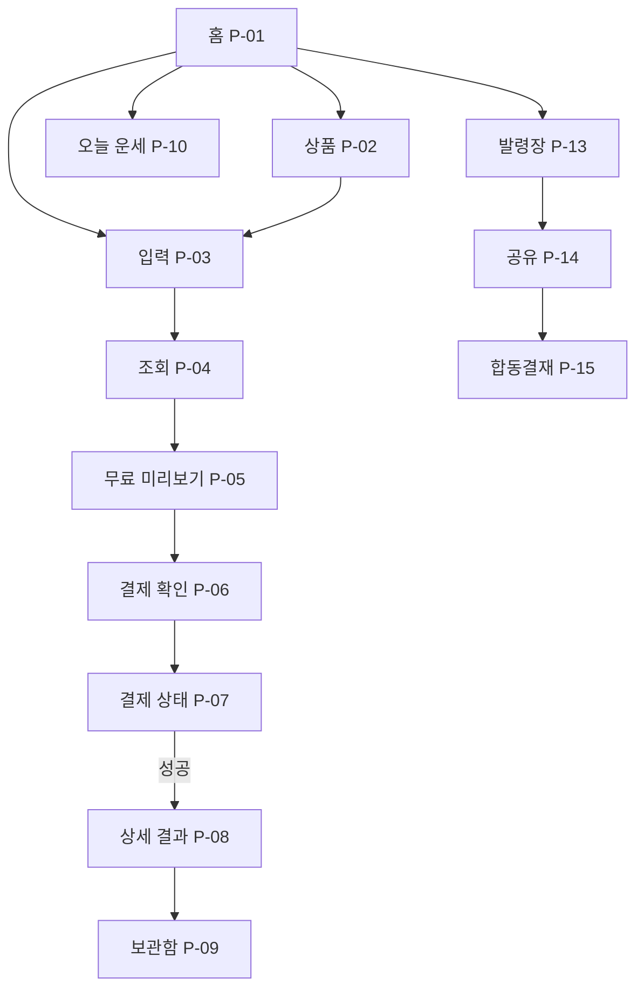

# 01. 페이지 구성 · IA · 페이지별 기능 명세

> **현재 구현:** `/`, `/reading/new`, `/reading/processing/[id]`, `/reading/preview/[id]`, `/checkout/[id]`, `/readings/[id]`, `/library`, `/today`, `/support`. `[id]`는 두 종류의 개발용 샘플 ID다. 상품 소개는 홈·구매 화면에 통합했고 구매 상태는 checkout 내부에서 표현한다. 아래 전체 맵의 나머지 라우트는 후속 기획이다. 시제품은 입력 복구를 보장하지 않고, 상단 홈 링크와 화면별 이동 링크를 제공한다. 구체적인 상태·저장 정책은 [시제품 안내](11-local-prototype.md)를 따른다.

> 각 페이지의 `P0`는 MVP 필수, `P1`은 우선 후속, `P2`는 장기 확장. 경로는 **권장 라우트 초안**이며 코드 구현에서 변경 가능하다.

## 1. 모바일 전용 네비게이션 규칙

- 주 하단 탭(초기 4개): **홈 / 오늘 운세 / 천계친구 / 보관함**.
- `천계친구`는 Phase 2 이전에는 숨긴다. MVP에서는 **홈 / 오늘 운세 / 보관함** 3개 탭만 노출하여 빈 화면 방지.
- 입력, 결제, 결과 읽기 페이지는 하단 탭을 감추거나 간소화하여 주요 행동에 집중시키고 상단 뒤로가기만 표시한다.
- 상단 바: 좌측 뒤로가기(서브) 또는 로고(홈), 중앙 페이지명, 우측 도움말·프로필. 긴 랜딩 전용 GNB는 사용하지 않는다.
- 스크롤 복원: 탭 전환/뒤로가기 시 이전 리스트 위치 보존. 폼 데이터 입력 도중 이탈 시 복구/확인.
- 사용자의 기기 너비가 430px보다 넓으면 폭 430px 중앙 앱 셸을 유지하고 배경만 확장. 임의 2~3열 PC UI 금지.

## 2. 전체 페이지 맵

| ID | 우선순위 | 페이지명 | 추천 경로 | 진입 | 핵심 목적 |
| --- | --- | --- | --- | --- | --- |
| P-01 | P0 | 홈 | `/` | 직접/공유 | 서비스 가치 이해·상품 시작 |
| P-02 | P0 | 사주 상품 소개 | `/products/:slug` | 홈 카드 | 상품 범위/가격 이해 |
| P-03 | P0 | 운명 정보 입력 | `/reading/new?product=:slug` | 상품/홈 CTA | 명식 정보 수집·검증 |
| P-04 | P0 | 운명록 검색 | `/reading/processing/:requestId` | 입력 완료 | 처리 진행·대기 오류 처리 |
| P-05 | P0 | 무료 운명록 | `/reading/preview/:readingId` | 검색 완료 | 무료 가치 전달·유료 선택 |
| P-06 | P0 | 결제 전 확인 | `/checkout/:orderId` | 유료 CTA | 가격/범위/규정 확인 |
| P-07 | P0 | 결제 처리·결과 | `/checkout/:orderId/status` | PG 반환 | 결제 확정·재시도·복원 |
| P-08 | P0 | 상세 운명록 | `/readings/:readingId` | 결제 완료/보관함 | 유료 내용 읽기·다시 보기 |
| P-09 | P0 | 보관함 | `/library` | 하단 탭 | 구매한 풀이 탐색·재열람 |
| P-10 | P0 | 오늘 운세 | `/today` | 하단 탭 | 무료 재방문 동기 |
| P-11 | P0 | 계정/복원 | `/account` | 헤더/결제 | 로그인·구매 복원·삭제 |
| P-12 | P0 | 지원·정책 | `/support`, `/legal/*` | 푸터/계정 | 문의·환불·개인정보 |
| P-13 | P1 | 천계 발령장 | `/assignment` | 홈/공유 | 재미있는 무료 유형 카드 |
| P-14 | P1 | 발령장 공유 페이지 | `/a/:shareToken` | 메시지 링크 | 친구 유입·내 발령장 만들기 |
| P-15 | P1 | 합동결재서 | `/collab/:inviteToken` | 친구 초대 | 둘의 천계 역할 조합 결과 |
| P-16 | P2 | 궁합/추가 풀이 | `/products/compatibility` | 상품/결과 | 추가 주제 구매 |

경로에 **이름, 생년월일, 생시**를 직접 넣지 않는다. `readingId`와 `shareToken`은 추측 불가한 불투명 식별자여야 한다.

## 3. 탭/페이지 동선

## 4. 페이지별 세부 명세

### P-01. 홈 (`/`) · P0

**목표:** 5초 안에 '누가 무엇을 해주며 얼마인지' 알게 한다.

**화면 구성 (위→아래)**
1. 컴팩트 상단: 천명록 로고, 보관함/프로필 진입.
2. 히어로: 운몽이 공식 에셋 + '안녕하세요! 천계 운명관리소의 견습 신선 운몽이에요!' + `내 운명록 찾아보기`.
3. 주력 상품 카드: 종합 사주 · **990원** / 무료로 먼저 보는 항목 표시.
4. 카테고리 퀵 카드: 오늘 운세(무료), 연애운/올해운세(준비 시 비노출 또는 '준비 중' 명시).
5. 서비스가 어떻게 동작하는지 3단계 (입력→무료 열람→원하면 유료 열람).
6. 발령장 프로모션(P1 출시 시); 실제 후기/FAQ/회사·정책 링크.

**기능 목록:** 상품 목록 조회, 최근 구매 이어보기, CTA 라우팅, 로그인 상태 반영, 무료 오늘 운세 링크, 서비스 소개.

**상태:** `신규` 안내 / `복귀` 최근 읽던 페이지 / `상품 비활성` 가격·버튼 숨김 / `로딩 실패` 재시도.

**이벤트:** `home_view`, `home_primary_cta_click`, `product_card_click`.

**검수:** 390px에서 캐릭터와 CTA가 첫 화면 안에서 읽히며, 가격은 상품 CTA 근처에 나타남.

### P-02. 상품 소개 (`/products/:slug`) · P0

**화면:** 상품 제목·990원 가격 / 누가 풀어주는지 / 제공 항목 4~6개 / 예시 문단 / 예상 읽기 분량(측정 가능한 경우만) / 무료·유료 범위 / 개인정보 입력 안내 / CTA.

**기능:** 상품 SKU 조회, 구매자라면 `다시 읽기` 전환, 구매 전 가격/제공 범위/추가요금 유무 노출.

**카피:** '운몽이와 내 운명록부터 펼쳐볼까요?' / `무료 미리보기 시작하기`.

**검수:** 상품명과 결제 금액을 본 상태로 사용자가 다음 단계로 이동 가능.

### P-03. 운명 정보 입력 (`/reading/new`) · P0

**필드:** 생년·월·일(필수), 양력/음력(필수), 윤달 여부(음력일 경우), 태어난 시각(선택 / 모름 가능). 사주 풀이에서 성별을 활용하려면 **목적과 이유를 설명한 선택 항목**으로 별도 설계하고, 없어도 기본 경로 진행 가능하게 한다. 출생지·시간대가 필요한 계산기는 구체적인 수집 필요성 검증 후 추가.

**화면:** 단계 인디케이터 `1/2` / 운몽이 캐릭터 작은 표정 / 필드별 도움말 / `태어난 시간을 몰라요` 토글 / 개인정보 수집 설명 / `내 운명록 찾아보기` 고정 CTA.

**유효성:** 존재하지 않는 날짜/미래일자/음력 윤달 조합 방지, 시각 모름 지원, 중복 요청 방어, 키보드 입력 가능, 특정 시각 변경 시 결과 영향 알림.

**상태:** 임시 저장(사용자 동의/세션 한정), 입력 에러 필드 아래, 전체 서버 오류 재시도, 뒤로가기 시 입력 보존.

**카피:** '태어난 시간을 몰라도 괜찮아요. 일부 해석은 달라질 수 있어요.'

**검수:** 320px에서도 필드 누락 없이 진행되고 스크린리더 레이블 제공.

### P-04. 운명록 검색 (`/reading/processing/:requestId`) · P0

**화면:** 서고에서 두루마리를 찾는 운몽이 애니메이션, '천계 서고에서 기록을 찾고 있어요', 단계 힌트.

**기능:** 서버 작업 폴링/스트리밍, 완료 시 안전한 자동 전환, 장시간 지연 시 `다시 시도`·`홈으로`·비동기 확인 가능한 상태 URL, 이탈·재진입 복원.

**주의:** 가짜 0~100% 완료율/비현실적인 예상 시간 금지. 결제 전에는 유료 결과를 선생성할지 비용 계산 후 결정.

**검수:** 요청을 중복 호출해도 읽기 결과 1개만 연결.

### P-05. 무료 운명록 (`/reading/preview/:readingId`) · P0

**화면:** 사용자가 제공한 입력 요약 / 운몽이 한 줄 인사 / 오행 또는 핵심 기질 시각화 / **실제로 읽을 수 있는** 2~3개 문단 / '이 풀이에서 더 다루는 것' 목차 / 상세 구매 카드.

**기능:** 무료 미리보기 열람·공유 가능한 **개인정보 없는** 요약 카드(P1), 관련 상품 선택, 이미 구매한 권한 검사, 입력 수정 → 재계산.

**카피:** '제가 먼저 찾아본 기록은 여기까지예요!' / '더 자세한 이야기는 담당 신선님께 여쭤볼게요.' / `990원으로 상세 운명록 열람`.

**가드레일:** 무료 내용을 일부러 모호한 위협으로 마무리하지 않는다. 구매하지 않아도 무료 결과에 의미가 있어야 한다.

**검수:** 가격·목차·결제 전에 제공되는 내용의 경계 명확.

### P-06. 결제 전 확인 (`/checkout/:orderId`) · P0

**화면:** 상품/적용 프로필/포함된 챕터 / 최종 990원(세금 포함 여부 명시) / 결제수단 / 이용 조건·결제 취소 안내 / 동의(필수/선택 분리) / `990원 결제하고 열람하기`.

**기능:** 서버 주문 생성, 구매 중복 검사, 결제창 띄우기, 주문 재개, 환불 안내, 접근성 포커스 처리.

**가드레일:** '선배님께 결재 요청'만 결제 CTA로 쓰지 않는다. 실제 금전 **결제**임을 버튼에 명시.

**검수:** 구매자는 같은 콘텐츠에서 '이미 열람 가능' 상태로 이동.

### P-07. 결제 상태 (`/checkout/:orderId/status`) · P0

**상태별 화면:**
- `PENDING`: '결제 결과를 확인하고 있어요. 이 화면을 닫아도 구매 내역을 다시 확인할 수 있어요.'
- `PAID`: 서버 검증 후 결재 도장 애니메이션, `운명록 열람하기`.
- `FAILED`: '결제가 완료되지 않았어요. 청구 여부를 확인한 뒤 다시 시도해 주세요.'
- `CANCELED`: '결제를 취소했어요. 무료 운명록으로 돌아갈 수 있어요.'
- `UNKNOWN/DELAYED`: 결제내역 조회/고객센터 안내, **성공/실패 단정 금지**.

**기능:** 서버 PG 승인 검증, 중복 웹훅 방어, 읽기 권한 생성, 복원, 에러 시 고객지원.

### P-08. 상세 운명록 (`/readings/:readingId`) · P0

**화면:** 승인 도장(첫 회만), 보고서 제목, 챕터 목차, 기질/관계/일/돈 관리 습관/실천 조언의 다섯 섹션, 해석 근거 표기(표현 가능한 범위), 요약/생활 실천 조언, 관련 상품 추천(읽기 종료 후), 보관함.

**기능:** 구매 권한 확인, 보고서 다운로드/이미지 공유 여부는 P1, 챕터 내비게이션, 읽던 위치 복원, 이해되지 않는 풀이의 간단한 설명(무료), 오류 시 복원.

**검수:** 본문 도중 가리는 업셀 금지. 명식과 AI 해석을 구분.

### P-09. 보관함 (`/library`) · P0

**화면:** 구매된 운명록 리스트 (타이틀/구매일/프로필 별칭/다시 보기) / 빈 상태 / 구매 복원 / 정보 수정 시 새 풀이 정책 안내.

**기능:** 로그인 또는 구매 연결, 보관함 필터, 읽기, 접근 만료 정책이 있다면 명시, 계정 간 권한 혼동 방어.

**빈 상태:** '아직 보관된 운명록이 없어요. 운몽이와 첫 번째 기록을 찾아볼까요?'

### P-10. 오늘 운세 (`/today`) · P0

**화면:** 오늘 날짜, 운몽이 짧은 코멘트, 오늘의 키워드, 에너지/관계/할 일의 소소한 조언, `내 운명록 보러가기`.

**기능:** 날짜 기준 일별 결과 캐싱, 태어난 정보 미입력 시 일반 콘텐츠와 개인화의 구분, 공유(개인정보 제거), 일일 재방문 경로.

**주의:** 매일 결과가 반드시 새 운명의 '기록 변경'이라는 실재 주장 대신 '오늘의 해석이 도착했어요' 사용.

### P-11. 계정/구매 복원 (`/account`) · P0

**화면:** 로그인/프로필, 구매 복원, 문의, 이용약관, 개인정보처리방침, 데이터 삭제 요청.

**기능:** 간편로그인/비회원 정책(확정 전), 구매 영수증/주문 ID 조회, 데이터 접근·삭제, 다중 프로필(후순위).

**검수:** 로그인 없이 결제한다면 최소한 재열람/복원 수단과 명확한 안내가 있어야 함.

### P-12. 고객지원·정책 (`/support`, `/legal/*`) · P0

**화면:** FAQ, 상품 구매/복원, 결제 문의, 환불/청약철회 정책, 개인정보 보관/삭제, 서비스 문의 채널, 사업자 정보(출시 전 실제 정보).

**주의:** 법적 고지는 운영 주체와 PG·전자상거래 정책 확정 후 전문가 검토.

### P-13. 천계 발령장 (`/assignment`) · P1

**화면:** '운몽이가 당신의 천계 부서를 찾아드려요' → 무료 발령장 만들기 → 부서/직책/한 줄 설명 → 이미지 저장/링크 공유.

**기능:** 재현 가능한 유형 판정, 개인 식별 정보 제거, 사용자 친화적인 문장, 공유 템플릿 1:1 또는 9:16.

### P-14. 공유 페이지 (`/a/:shareToken`) · P1

**화면:** 공개 발령장(별칭은 사용자가 동의한 경우에만), `나도 발령장 받기`, `함께 일하면 어떤 팀일까?` CTA.

**기능:** 토큰 만료/폐기, Open Graph 썸네일, 앱 미설치 상태에서 즉시 이용, 원래 사용자 개인정보 미노출.

### P-15. 합동결재서 (`/collab/:inviteToken`) · P1

**화면:** 두 발령장의 조합, '함께 잘하는 일' 2개, '서로 배려할 점' 1개, 몽실이 도장, 공동 결과 카드 저장.

**기능:** 초대 생성/수락, 명시적 정보 공개 동의, 제3자 데이터 입력 금지(본인이 직접 참여), 친구 거절/링크 종료.

### P-16. 추가 상품 확장 (`/products/compatibility`) · P2

**화면:** 궁합/재물/직업 등 개별 상품의 명확한 해석 범위와 가격.

**기능:** 독립 SKU, 이전 풀이 기반 부가 섹션, 새 정보 입력 권한, 보관함/결제 복원 연동.

## 5. 공통 UI 상태 표준

- `loading`: 스켈레톤/운몽이 애니메이션; 무한 회전만 표시 금지.
- `empty`: 서비스 맥락이 있는 문장+명확한 하나의 CTA.
- `error`: 오류의 의미, 현재 상태, 다시 시도/문의 링크를 함께 표시.
- `unauthorized`: 구매 결과는 로그인/구매권한 검증을 통해서만.
- `offline`: '연결이 잠깐 끊겼어요. 다시 연결해서 이어볼까요?' + 재시도.
- `expired`: 공유 링크와 구매 접근권한을 구분해 처리.

## 6. MVP 구현 순서

`P-01` → `P-02` → `P-03` → `P-04` → `P-05` → `P-06` → `P-07` → `P-08` → `P-09` → `P-10` → `P-11/P-12` → (후속) `P-13~P-15`.
