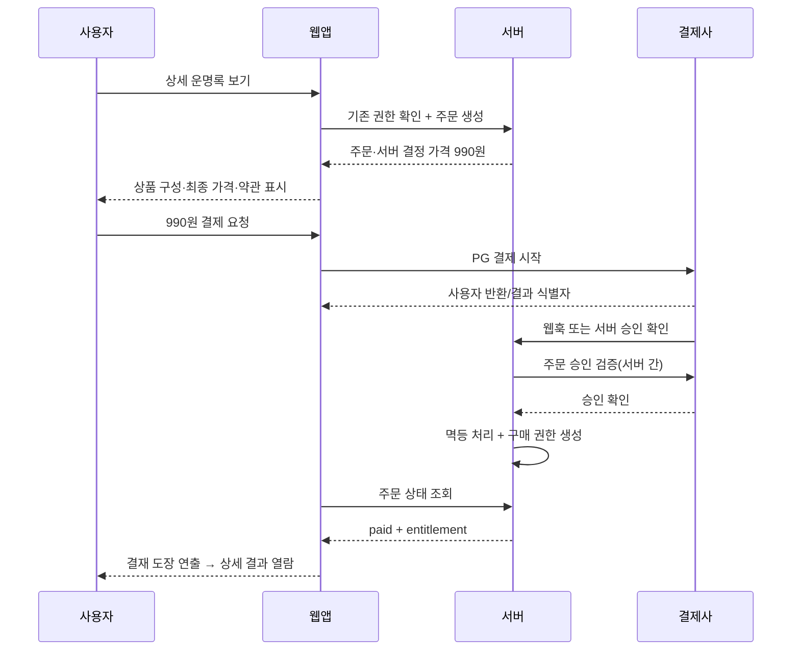

# 05. 상품·소액결제·결재 연출 설계

> **현재는 모의 구매만 구현:** 실제 PG·주문·인증·청구는 없다. 종합·애정·올해 가격안 990원, 나머지 가격 미정과 모든 상품의 체험 청구액 0원을 구분하며, 상세 내용은 공개 샘플이다. 같은 상품·샘플은 다시 모의 구매하지 않고 보관함에서 연다. sessionStorage의 상태는 탭 내 체험 용도이며 실제 권한이 아니다. 취소·실패·재시도·초기화를 재현한다. 아래 서버/PG·계정 복원·환불 정책은 후속 실제 서비스 설계다.

## 1. 용어 및 목표

- **실제 결제(Payment):** 990원을 지불하는 경제 행위. 서버와 PG 결과로만 성공 판단.
- **세계관 결재(Approval):** 천계 선배 신선이 서류를 승인한다는 **성공 후 애니메이션**. 실제 검수자나 추가 비용이 있다고 오인시키지 않는다.
- 목표: 무료 결과가 가치 있도록 제공하면서 990원 상품의 구성·가격·권리를 투명하게 알리고, 결제 실패/재진입/중복 결제 문제를 줄이는 것.

## 2. 상품 카탈로그

현재 체험 ID는 `basic`, `love`, `career`, `money`, `year`, `decade`, `compatibility`다. 실행 카탈로그는 [catalog.ts](../src/features/products/catalog.ts)이며 모든 상품이 독립적으로 체험 가능하다. 종합·애정·올해만 990원 가설을 표시하고 직업·재물·대운·궁합은 가격 미정이다. 최종 청구액은 모두 0원이다. 올해는 2026년 예시, 대운은 가상 구간 A·B·C다. 궁합은 두 사람의 입력 동의를 확인한다. 모의 구매는 동일 샘플만 열며 다른 상품 권한을 부여하지 않는다.

아래 SKU와 출시 순서는 **후속 실제 판매 가설**이다. 체험 ID와 실제 주문 SKU를 혼용하지 않는다.

| SKU | 상품명 | 가격(안) | 노출 시점 | 주요 구성 | MVP |
| --- | --- | --- | --- | --- | --- |
| `saju_basic_v1` | 내 운명록 · 종합 사주 | 990원 | 홈/무료 결과 | 기질, 관계, 일, 돈 관리 습관, 실천 조언 | O |
| `love_v1` | 인연부 · 연애운 | 990원 | 종합 결과 후 | 연애 패턴, 관계 조언, 시기별 해석 | P1 |
| `year_v1` | 올해의 운명록 | 990원 | 홈/종합 결과 후 | 연간 테마, 분기별 흐름 | P1 |
| `money_v1` | 재물부 · 재물운 | 미정(990원 검토) | 카테고리 확장 | 돈을 다루는 습관·해석 | P2 |
| `career_v1` | 관운부 · 직업운 | 미정(990원 검토) | 카테고리 확장 | 일 스타일, 시기별 점검 | P2 |
| `compat_v1` | 두 사람의 인연록 | 미정 | 두 사람 동의 확인 시 | 궁합 해석 | P2 |

**가격 확정 전 필요:** 실제 결제수수료·세금·AI 생성 단가·고객지원/환불 비용 계산. 최종 표시 가격은 판매 대상 국가/통화 기준으로 관리. 특정 상품 구매가 다른 상품 구매를 요구하는 구조 지양.

## 3. 무료/유료 범위

### 무료

- 자신의 입력 정보 요약(수정 가능)
- 태어난 날에 따른 기본 성향 2~3문단
- 설명 가능한 오행 분포 시각화(정확한 만세력 계산이 뒷받침될 때만)
- 한 가지 스스로 실천해볼 조언
- 무료 발령장(P1)

### 유료(990원 종합 사주)

- 성격·기질의 상세한 서술
- 관계 패턴과 소통에 대한 조언
- 일·재물에 관한 해석(전문 투자 추천 아님)
- 돈을 다루는 습관에 관한 설명 (올해·월별 흐름·대운 제외)
- 결과 요약과 실천 가이드
- 보관함 재열람 조건(접근 기간/복원 정책) 명시

실제 제공 챕터와 분량을 출시 전 샘플 보고서로 확정. **결제 전 미리보기에서 보여준 분량을 고의로 잘라 공포를 자극하지 않는다.**

## 4. 구매 여정

**불변 조건:** 클라이언트 `success` 리다이렉트만으로 구매 권한 발급 금지. 승인 검증, 금액, 통화, merchant order ID, 중복 webhook 확인 필요.

## 5. 상태 머신

| 상태 | 의미 | 사용자 노출 | 다음 행동 |
| --- | --- | --- | --- |
| `DRAFT` | 구매 시도 전 | 상품 보기 | 주문 확인 |
| `READY` | 서버 주문 생성 | 990원 결제하기 | PG 진입 |
| `PENDING` | PG 결과 확인 중 | 결제 확인 중 | 폴링/재조회 |
| `PAID` | 서버 승인 완료 | 구매 완료·결재 도장 | 열람 |
| `FAILED` | 결제 실패 확정 | 결제 실패 | 재시도 |
| `CANCELED` | 사용자가 중단 | 무료 결과로 돌아가기 | 돌아가기 |
| `UNKNOWN` | 결과 지연·불명 | 중복 결제하지 말고 확인 | 복원/지원 |
| `REFUNDED` | 환불 완료 | 구매 상태 안내 | 권한 정책 반영 |

`UNKNOWN` 상태에서 같은 주문 중복 PG 호출을 허용하지 않음. 조회 후 명확히 실패·취소가 확인되면 새 결제 시도 허용.

## 6. 중복 과금·복원 방어

1. 결제 페이지 열기 전에 `entitlement` 조회: 기존 상품/프로필/기간/리포트 버전 기준 동일 권한이 있으면 `이미 구매함` 노출.
2. 서버 주문에 `idempotencyKey` 사용; 새로고침/중복 클릭/웹훅 중복 시 단일 승인.
3. 웹훅을 진실 원천으로 삼되 PG 문서에 맞는 서버 조회도 지원.
4. 승인과 권한 생성은 원자적 처리 또는 재실행 안전 로직.
5. 외부 PG 승인 확인이 늦어지면 `UNKNOWN`과 구매 확인 경로 제공.
6. 구매 후 리포트 생성이 실패하면 사용자는 결제 재시도 아닌 **결과 재생성·고객지원**을 이용.
7. 비회원 결제는 계정 연결/기기 변경 복원 정책이 마련되지 않았다면 출시 금지 또는 로그인 필수로 정책 명시.

## 7. 업셀·크로스셀 설계

| 시점 | 트리거 | 예시 문구 | 제한 |
| --- | --- | --- | --- |
| 무료 결과 하단 | 사용자가 무료 풀이를 읽음 | `담당 신선님께 여쭤볼까요? 990원 결제하고 상세 열람` | 무료 내용을 가리지 않음 |
| 구매 결과 마지막 | 결제한 결과를 다 읽음 | `인연부의 기록도 궁금하세요?` | 자동 팝업 금지 |
| 보관함 | 다른 주제 관심 선택 | `올해의 운명록 펼쳐보기` | 이미 구매한 상품은 재열람으로 |
| 오늘 운세 | 하루 콘텐츠 확인 | `조금 더 길게 보고 싶다면 내 운명록 보러가기` | 무료 결과 제공 후 |
| 발령장 | 친구 공유 완료 | `서로의 천계 업무 조합도 볼까요?` | 신규 유료 상품과 명확히 구분 |

결제 금액을 낮게 표시하고 결제 직전에 추가 수수료를 붙이는 방식 금지. '지금 안 보면 큰일' 등 허위 긴박감 금지.

## 8. 리포트 접근 권한 정책 (운영 결정 필요)

- **권장 정책:** 동일 입력과 동일 상품 버전의 구매 리포트를 계정 보관함에서 계속 재열람 (단, 서비스 종료/환불 등 약관에 반영된 예외).
- 입력 생년월일을 고치면 동일 리포트를 바꾸지 않음. 수정된 입력은 새로운 리포트이며, **새 구매 필요한지** 사전에 알려야 함.
- 동일 연도별 콘텐츠는 `period`를 권한 키에 포함. 다음 연도의 상품 구매 요구가 있다면 명확히 사전 설명.
- 결제 상품을 고쳐도 이미 구매한 리포트 접근 권한을 예고 없이 박탈하지 않음.

## 9. 환불·정책·고객지원

- 운영 주체와 판매 국가의 전자상거래/소비자보호법 및 PG 조건에 맞는 고지 필요.
- 디지털 콘텐츠 제공 시작, 청약철회 제한, 환불 예외는 법률 검토 후 UI에 반영. 단순히 '디지털 상품 환불 불가'로 일괄 고지하지 말 것.
- 영수증/거래 ID/상품명/시각/결제 상태 확인 가능한 문의 경로 마련.
- 사주 풀이 결과를 근거로 확정적인 의료·법률·투자 결정을 권유하지 않는다.

## 10. QA 필수 시나리오

- [ ] 결제 전 금액/제공 범위가 선명하게 표시됨
- [ ] PG 취소 후 카드 청구 여부 상태를 오인하지 않음
- [ ] PG 반환과 웹훅 순서가 뒤바뀌어도 유효
- [ ] 같은 주문 웹훅 2회에서도 단일 권한 생성
- [ ] 새로고침/백버튼/네트워크 단절 후 복원
- [ ] 결제 승인 후 보고서 생성 실패 시 재결제 요청하지 않음
- [ ] 기존 구매자는 재결제 없이 원본 보고서 열람 가능
- [ ] 결제 성공 뒤에만 도장 애니메이션 실행
- [ ] 환불 시 표시와 접근 정책 일치
