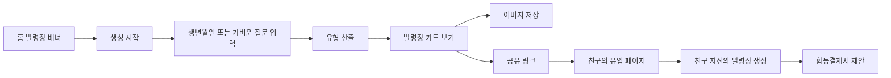

# 06. 천명록 시그니처 기능 · 친구 초대 · 공유 설계

## 1. 왜 이 기능이 필요한가

대부분의 사주 콘텐츠는 한 번 보고 끝나는 구매 경험이 되기 쉽다. 천명록은 **'내가 어떤 신선인지'를 보여주는 재미있는 무료 카드**를 만들고, 친구가 참여할 때 **함께 해야 완성되는 이야기가 생기는 구조**로 초대 동기를 만든다.

**차별화 포인트:** 단순히 '궁합 몇 점', '귀인 지도'를 복제하지 않고 **천계 직장 세계관**을 활용한 `발령장 → 초대 → 합동결재서`로 진행한다.

## 2. 시그니처 A: 천계 발령장 (P1 최우선)

### 컨셉

사용자가 자신의 재미있는 성향을 선택지 또는 제한된 사주 해석으로 확인하면, 천계 운명관리소의 '부서'와 '직책'이 정해지는 **공유형 유형 카드**.

### 부서/직책의 예시 (확정 아님)

| 부서 | 키워드 | 카드 결과 예시 |
| --- | --- | --- |
| 인연부 | 공감, 소통 | `인연부 · 분위기 담당` |
| 기록부 | 관찰, 세심함 | `기록부 · 숨은 디테일 수집가` |
| 기획부 | 판단, 계획 | `기획부 · 계획표 마스터` |
| 구름부 | 배려, 쉼 | `구름부 · 마음 온도 조절사` |
| 별빛부 | 상상, 영감 | `별빛부 · 반짝임 발견가` |
| 풍요부 | 실용, 꾸준함 | `풍요부 · 작은 기회 수집가` |

유형명은 낙인을 찍지 않는 긍정적인 문구로 한다. '재물 성향'을 근거 없는 금융 능력으로 단정하거나 성향을 사람의 고정적 성질로 규정하지 않는다.

### 플로우

### 카드 구성

- 상단: `천계 운명관리소 · 발령장 제OOO호` (번호는 개인정보 노출 없는 무작위/가상 식별자)
- 가운데: 운몽이/몽실이 승인 에셋 + 부서명/직책
- 아래: 1문장 유형 해설, 보조 키워드 2개
- 하단: `천명록` 서비스명 + 친구 유도 문구/QR 또는 안전한 공유 링크
- 개인 이름/생년월일/태어난 시간/정확한 사주팔자는 **기본적으로 표시하지 않음**.

### 결과 예문

> 축하해요! 천계 **기록부 · 숨은 디테일 수집가**로 발령되었어요. 작은 변화를 먼저 발견하는 관찰력이 돋보이는 유형이에요.

### 계산 방식

1. MVP/P1에서는 **서비스 내부 질문 3~5문항**의 응답을 우선하여 가벼운 유형을 생성(민감 입력 없이 진입 가능).
2. 사주 명식을 이용한다면 정확한 산출 모듈·결정 규칙과 사용자 고지를 먼저 마련.
3. 동일한 답변/시드로는 동일 발령장이 나오도록 **결정론적 매핑**.
4. 유형 데이터는 `assignment_rule_version`으로 버전 관리.

## 3. 시그니처 B: 합동결재서 (P1 두 번째)

### 컨셉

친구 A가 초대 링크를 보내면 B가 스스로 발령장을 만든 후 두 발령장을 조합한 **천계 합동 업무** 카드를 발급한다.

### 예시

- A: `인연부 · 분위기 담당`
- B: `기획부 · 계획표 마스터`
- 합동 프로젝트: **'천계 신입 환영회 기획팀'**
- 잘 맞는 업무: `분위기를 살리면서 계획을 실행하기`
- 서로 배려할 점: `계획을 바꾸기 전 한 번씩 의견을 묻기`
- 이미지 하단: `우리 조합도 천계에서 발령받기`.

### 규칙

- 상대의 생년월일/비공개 풀이를 직접 입력하는 방식보다 **상대방이 스스로 참여하고 동의하는 방식**을 기본으로.
- 결과는 심리 유형 놀이/캐릭터 조합으로 설명하며 관계의 미래 확정·연애 성공률 예언 금지.
- 초대 링크에 만료/폐기 기능, 토큰 추측 방지, 공개 정보 범위 동의 제공.
- 누가 초대했는지, 카드를 저장했는지 등의 이벤트는 익명화·집계하고 민감 입력을 수집하지 않음.

## 4. 시그니처 C: 천계 미션 우체통 (P2 아이디어)

오늘 운세를 보면 운몽이가 '오늘의 작은 미션' 한 개를 건넨다. 예: `고마웠던 사람에게 짧은 안부 보내기`, `10분 산책`, `미루던 연락 하나 정리`. 수행하면 구름 도장 한 장을 얻고 달력에 모인다.

**장점:** 매일 들어올 이유가 있고, 친구에게 미션 카드만 공유하기도 편함. 다만 강한 알림 유도·스트릭 상실 압박은 피한다.

## 5. 시그니처 D: 운명록 한 페이지 선물하기 (P2 아이디어)

구매한 유료 풀이 **전체를 무단 공개하는 게 아니라**, 사용자 본인이 선택한 비민감 1문장을 예쁜 두루마리 카드에 담아 공유한다.

- 원문/생년월일/이름 자동 삽입 금지.
- `공유 카드 보기` 단계에서 사람이 내용을 확인/편집.
- 카드 수신자는 `나도 내 운명록 찾아보기`로 진입.

## 6. 공유 UX 설계

### 진입점

1. 발령장 결과 하단: `친구에게 발령장 보내기`
2. 친구가 결과 완성: `우리 합동결재서 만들기`
3. 합동결재 완성: `같이 만든 결과 공유하기`
4. 무료 오늘 운세/풀이 하단: `오늘의 한 줄 공유하기`

### 공유 채널

- 브라우저 Web Share API 지원 시 기본 공유 시트.
- 미지원 시 링크 복사.
- 이미지 저장(파일 생성) 및 카카오톡 등은 실제 API 연동/개발 조건 검토 후 구현.
- 오픈그래프 썸네일은 민감한 개인정보를 포함하지 않는 정적/승인된 썸네일.

### 유입 페이지

- 상단: 친구가 만든 결과(공개 동의된 범위만)
- 중간: `천계에서 OO님의 동료가 되어볼까요?`
- CTA: `내 발령장 받아보기`
- 결과 후 합동결재 제안.
- 입장한 친구가 사이트를 처음 방문해도 로그인 없이 기본 경험 제공할 수 있도록 설계 (수익화/연결 정책 별도).

## 7. 실험 가설·지표

| 가설 | 측정 |
| --- | --- |
| 발령장이 예쁘고 짧으면 공유가 늘어난다 | 발령장 발급 대비 공유 시도 비율 |
| 상대가 참여해 결과가 완성되면 초대 수락률이 오른다 | 유효 링크 방문→완료율 |
| 친구 유입이 일반 광고 유입보다 무료 결과 완료율이 높을 수 있다 | 유입 source별 퍼널 |
| 합동결재가 유료 궁합 콘텐츠로 연결된다 | 합동결재→상품 상세 조회율(유료 강제 아님) |

전환율 목표치는 측정 전 임의로 숫자를 확정하지 않고 베이스라인 수집 이후 수립.

## 8. 악용 방지 및 개인정보

- 초대 링크의 수명 및 폐기 지원.
- SNS 미리보기 이미지에 이름/생일/사주팔자 노출 금지.
- 타인이 작성한 발령장/비밀 풀이를 승인 없이 공유 금지.
- 친구 추천 포인트/보상을 도입한다면 허위 초대·다계정 악용 및 광고 표시 정책 검토.
- 바이럴의 핵심은 협업 놀이이지, 사람의 운명이 비밀리에 공개되는 구조가 아니다.

## 9. 추천 우선순위

**가장 먼저 만들 기능은 무료 '천계 발령장'.** 출시 시 캐릭터 브랜드를 확산시키기 쉽고 초기 구현 범위를 제어하기 좋다. 합동결재는 단일 발령장 공유 데이터가 쌓이고 공유 API가 안정화된 뒤 출시.
