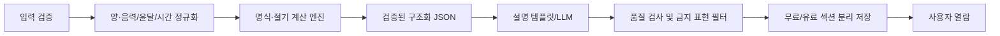

# 07. 기술 설계 초안 (개발 에이전트용)

> **현재 로컬 구현:** Next.js App Router + TypeScript, CSS Modules/CSS 변수, Vitest, Playwright를 사용한다. 계산·설명·구매는 클라이언트의 공개 샘플이며 실제 API·DB·AI·PG·로그인은 없다. 아래 객체·API·백엔드 추천안은 후속 연동 설계다. 현재 계약과 교체 경계는 [풀이 프롬프트 계약](12-reading-prompt-contract.md), 실행·저장 한계는 [시제품 안내](11-local-prototype.md)를 따른다.

> **Next.js 사용은 사용자 확정(2026-10-27).** App Router + TypeScript는 시제품에 구현했으며 아래 백엔드 구성은 후속 추천안이다. PG·DB 서비스·로그인 수단·호스팅은 아직 계약/선택되지 않았다.

## 1. 추천 스택

| 영역 | 권장 후보 | 이유/주의 |
| --- | --- | --- |
| 프런트 | Next.js App Router + TypeScript 구현 | 모바일 단일 페이지 구성과 동적 결과 라우팅 |
| 스타일 | CSS Modules + CSS 변수 토큰 (시제품 확정) | 컬러/간격 일관성, 디자인 시스템 확장 |
| 컴포넌트 | 접근성 검증된 headless UI 기반 | 입력·다이얼로그 접근성 확보 |
| API | Next.js Route Handlers + 서버 도메인 서비스 권장 | 초기 웹 API를 한 저장소에서 운영, 장시간 작업은 별도 worker |
| DB | PostgreSQL + SQL 마이그레이션 | 유저/주문/리포트/권한 일관성 |
| 파일 | 객체 스토리지 + CDN | 원본 캐릭터와 최적화 에셋 분리 |
| 인증 | 소셜 로그인/일회용 이메일 등 | 비회원 결제 허용 여부와 복원 정책에 따라 |
| 결제 | 한국에서 운영 가능한 국내 PG 제공사 | 수수료·소액결제·지원 수단 검토 필수 |
| 사주 엔진 | 검증된 만세력 계산 라이브러리/자체 모듈 | 절기·윤달·시간대 검증 선행 |
| 문장 생성 | 템플릿+LLM(필요 시) | 계산 엔진과 분리·버전/원가 관리 |

## 2. 저장소 구조 기준

파일 배치와 의존 방향의 단일 기준은 루트 [ARCHITECTURE.md](../ARCHITECTURE.md)다. 새 코드는 `src/app/`, `src/features/<feature>/`, `src/server/<domain>/` 등 해당 문서의 책임 경계에 배치한다. 이전의 루트 `app/`·범용 `lib/` 예시는 사용하지 않는다.

라우트 목록은 [IA](01-information-architecture.md)를 따른다. 예를 들어 `/reading/preview/:readingId`는 `src/app/reading/preview/[readingId]/page.tsx`에 대응한다. 디렉터리는 실제 구현이 필요할 때 만들며 이 문서의 객체·API 표는 구조 규칙과 별도의 도메인 설계 초안이다.

## 3. 핵심 도메인 객체 (제안)

| 객체 | 핵심 필드 | 비고 |
| --- | --- | --- |
| `User` | `id, authProvider, createdAt` | 삭제 정책 필요 |
| `BirthProfile` | `id, ownerId, birthDate, calendarType, leapMonth, birthTime, timeUnknown, createdAt` | 민감도가 높은 개인 기록, 암호화/권한 |
| `Product` | `sku, name, priceAmount, currency, includedSections, version, published` | 가격 서버 원장 |
| `ReadingRequest` | `id, profileId, sku, status, calcVersion, createdAt` | 멱등 키 연계 |
| `SajuCalculation` | `id, profileId, canonicalInputHash, pillars, engineVersion` | 명식 계산 결과 |
| `Reading` | `id, requestId, userId, freeContent, paidContent, contentVersion, status` | 저장/접근 분리 |
| `Order` | `id, userId, sku, profileId, amount, currency, status, pgPaymentId, idempotencyKey` | 단일 주문 유일성 |
| `Entitlement` | `id, userId, sku, profileId, readingId, purchasedAt, state, period` | 유료 열람 권한 |
| `Assignment` | `id, userId, assignmentCode, ruleVersion, publicShareId` | 성향 결과 카드 |
| `Invitation` | `id, creatorAssignmentId, inviteTokenHash, expiresAt, revokedAt` | 원문 토큰 저장 지양 |
| `CollabResult` | `id, invitationId, partnerAssignmentId, copyVersion` | 당사자 동의 |

**실제 출시 전:** 데이터 보존 기간, 삭제 방식, 외부 API 전송 여부, 접근 통제, KST 및 UTC 처리 검증 필요.

## 4. 사주 결과 생성 파이프라인

**정확도 검증 포인트**
- 한국표준시 및 입력지 시간대, 서머타임 역사.
- 음력/양력 변환·윤달 유효성.
- 절기 기준 월주, 날짜 경계와 자시(子時) 처리 정책.
- 출생시각 미상의 불확실성 고지.
- 기존 검증된 명식 샘플/다른 독립 엔진과 회귀 테스트.

**LLM 관리:** 실제로 입력한 사주 데이터에만 근거, 임의 사실 추가 금지, 고위험 예측 문장 제한, 결과 품질 평가. AI 모델/프롬프트/리포트 버전 저장. 개인 데이터를 모델 학습에 제공하지 않는 계약/설정을 확인.

## 5. API 초안

| Method | Endpoint | 목적 | 권한/보안 |
| --- | --- | --- | --- |
| GET | `/api/products` | 카탈로그 | 공개 |
| POST | `/api/reading-requests` | 입력 검증 및 비동기 계산 | rate limit, validation |
| GET | `/api/reading-requests/:id` | 계산 상태 | 소유권 |
| GET | `/api/readings/:id/preview` | 무료 결과 | 소유권/세션 |
| GET | `/api/readings/:id` | 전체 결과 | `entitlement` 필수 |
| POST | `/api/orders` | 서버 가격으로 주문 생성 | 세션/사용자/중복 방어 |
| POST | `/api/payments/confirm` | PG 승인을 서버 검증 | 주문·금액·PG 데이터 검증 |
| POST | `/api/payments/webhook` | 결제사 웹훅 | 서명 검증, 멱등 |
| GET | `/api/orders/:id` | 결제 상태/복원 | 소유권 |
| GET | `/api/library` | 구매 결과 | 인증/권한 |
| POST | `/api/assignments` | 발령장 생성(P1) | rate limit |
| POST | `/api/invitations` | 친구 초대(P1) | 토큰 만료/취소 |
| DELETE | `/api/me/data` | 삭제 요청 처리 | 재인증·정책 |

참고용 엔드포인트이며 실제 인증/세션 방식에 맞춰 변경할 것.

## 6. 보안·개인정보 필수 요구

1. 서버에서 전 필드 유효성 검증 및 제품·금액 결정.
2. API에 UUID가 있다고 무조건 접근을 허용하지 않음: 객체 수준 인가 검증.
3. 리포트/출생 정보가 URL, 광고 픽셀, 분석 도구에 노출되지 않도록 차단.
4. 출생 정보 DB 저장 시 암호화, 접근 최소화, 로그 마스킹.
5. PG 비밀키와 웹훅 서명 서버 보관, 주문 권한 및 영수증 접근 통제.
6. 공유 토큰은 추측 불가, 만료 가능, 철회 가능, 공개 데이터만 반환.
7. 개인정보처리방침에 목적/보관 기간/파기/제3자 처리/문의 채널 명시.
8. 고위험 의료·투자·법률 결정을 사주 결과로 단정하지 않도록 응답 검토.
9. 외부 LLM 사용 시 개인정보 최소화 및 제3자 처리에 대한 근거 점검.
10. 결제 승인 후 결과 생성 실패 시 재시도 큐/데드레터/복원 경로 확보.

## 7. 앱 셸 기술 메모

디자인 값과 CSS 토큰의 단일 기준은 루트 [DESIGN.md](../DESIGN.md)다. iOS 스크롤·인풋 포커스와 safe area를 검증한다. 네이티브 앱/스토어 등록은 MVP 범위 밖이다.

## 8. 구현 전에 결정해야 할 항목

- 명식 계산 엔진·근거 데이터/단위 테스트 코퍼스
- 한국 소액결제 지원 PG 및 실제 최소 수수료
- 간편 로그인·비회원의 구매 복원 정책
- 조회/생성 동기/비동기 전략과 API 비용
- 보고서 접근 기간·환불·청약철회 운영 정책
- 이벤트 데이터 최소화·보존 기간

## 9. MVP 백엔드 구현 추천안

**추천: Next.js 서버 API + 관리형 PostgreSQL + 관리형 인증 + 영속 작업 큐/worker.** DB·인증 통합 후보는 Supabase다. 웹 배포 후보는 Vercel이며, worker 호스팅은 장시간 실행·재시도·배포 리전 조건을 보고 결정한다. 현재는 구조 제안으로, 서비스 가입·과금·패키지 설치를 수행한 상태가 아니다.

### 책임 분리

| 계층 | 책임 | 경계 |
| --- | --- | --- |
| Next.js Server Components | 초기 화면·서버 조회 | 서버 서비스 직접 호출, 자기 HTTP API를 불필요하게 왕복하지 않음 |
| Route Handlers / 필요한 Server Actions | 입력 검증, 인증·소유권, 요청·주문 접수, 상태 조회, PG callback/webhook | 공개 진입점마다 권한 검사. 클라이언트의 가격·구매완료 플래그 불신 |
| `src/server/<domain>/` | 가격, 주문, 권한, 출생정보, 리포트 도메인 규칙 | 웹과 worker가 같은 규칙 사용; 런타임별 서버 경계는 ARCHITECTURE.md 준수 |
| PostgreSQL | 주문·권한·리포트·작업의 영속 원장 | 유일 제약, 트랜잭션, 마이그레이션, 복원 가능한 백업 |
| Auth | 사용자 식별·세션 | 서버 검증 필수. 관리자 키는 클라이언트 금지 |
| 영속 큐 + worker | 명식 계산, LLM 생성, 검증, 재시도, 결제 대사 | HTTP 요청 종료나 새로고침과 무관하게 처리·복구 |
| 공개 정적 에셋 / 비공개 저장소 | 캐릭터 배포 / 개인 결과 파일 | 리포트는 공개 URL 금지; 서버 권한 후 제공 |

DB는 애플리케이션 서버를 통해 접근하는 방식을 기본으로 제안한다. Supabase Data API를 노출하는 테이블에는 RLS를 적용한다. RLS를 우회하는 서버 관리자 연결은 별도의 소유권 검사를 생략할 근거가 아니다. 사용자별 리포트는 공유 캐시에 넣지 않는다.

### 요청·생성 흐름

1. 비회원 무료 체험은 서버가 발급·검증하는 세션 소유자로 요청을 저장한다. 로그인 연결 시 소유권을 검증하며 기록을 이관한다.
2. 입력 정규화 → 결정론적 명식 계산 → 무료 결과. 상세 LLM 결과는 결제 검증 후 생성하는 방식을 기본 추천한다. 무료 제공 범위는 상품 결정에 맞춘다.
3. 서버는 `ReadingRequest`와 작업 레코드를 원자적으로 저장하고 작업 ID를 반환한다. 화면은 인증된 상태 조회로 진행 상황을 표시한다.
4. worker는 작업을 임대/잠금하고 제한된 횟수로 재시도한다. 중복 수신에도 동일 리포트가 하나만 저장되도록 유일 키를 둔다. 실패 상한 이후 별도 실패 큐·관리자 재처리 경로를 제공한다.
5. 결과와 엔진·프롬프트·모델 버전을 저장하고 재열람에서는 저장 결과를 반환한다. 새로고침마다 LLM을 재호출하지 않는다.

큐 후보는 Supabase Queues다. 큐 자체가 코드를 실행해 주는 worker는 아니므로 소비자 실행 환경·스케줄·가시성 시간·재시도 상한을 함께 결정해야 한다. 결제/생성은 큐의 중복 전달 가능성을 고려해 멱등하게 구현한다. 요청 종료 후 메모리의 Promise만 남기는 방식은 사용하지 않는다.

### 결제·복구

- 주문 금액·상품 버전은 서버에서 고정하고 PG 승인 결과를 서버에서 대조한다.
- 승인 확인과 webhook이 경합해도 동일 결제 상태 전이 서비스를 호출한다. PG별 서명/진위 확인 방식은 선택한 PG 공식 명세에 맞춘다.
- `Order` 승인 상태·`Entitlement`·생성 작업 outbox를 같은 DB 트랜잭션으로 기록한다. outbox 발행 실패는 재처리한다.
- PG 외부 승인과 DB 트랜잭션은 하나로 묶을 수 없으므로, 불명 상태를 남겨 PG 조회 대사로 복구한다. 불명 상태에서 재결제를 유도하지 않는다.
- 동일 사용자/프로필/상품/기간/버전의 활성 구매 시도를 잠금/유일 제약으로 직렬화한다. 결제 ID, webhook 이벤트 ID, 권한 키에 각각 중복 방어를 둔다.
- 결제 상태와 생성 상태를 분리한다. 생성 실패는 재생성/지원 대상으로 처리하며 추가 청구하지 않는다. 환불 시 주문과 권한 정책을 일치시킨다.

### 인증·운영의 기본 추천

무료 미리보기는 비회원 허용, **유료 결제 전 로그인 필수**를 추천한다. 초기 복원 정책이 단순해지고 기기 변경 후 구매 내역을 찾을 수 있다. 로그인 수단은 카카오 또는 이메일 중 운영 여건에 맞춰 확정한다. 이 정책은 아직 사용자 확정 전이므로 결제 문서의 비회원 허용 정책을 임의 변경하지 않는다.

개발/스테이징/운영 데이터와 PG 키를 분리한다. 운영 전 백업 복원 실험, 관리자 재처리/환불 권한, 감사 기록, 비용·오류·큐 지연 알림을 준비한다. 초기 트래픽에서는 별도 NestJS/FastAPI 서버를 추가하지 않는 구성을 추천한다. 독립 API 고객이나 계산 엔진의 별도 언어 요구가 생기면 서비스 경계를 재평가한다.

### 공식 근거 (2026-10-27 확인)

- [Next.js Backend for Frontend](https://nextjs.org/docs/app/guides/backend-for-frontend): Route Handlers는 공개 HTTP 진입점이며 백엔드 전체를 대체하지 않는다. 위 서비스/worker 분리는 이 제약에 대한 프로젝트 설계 제안이다.
- [Supabase Next.js SSR 인증](https://supabase.com/docs/guides/auth/server-side/nextjs): 쿠키 기반 서버 렌더링 인증 구성. 로그인 수단과 세션 정책은 별도 결정한다.
- [Supabase Queues](https://supabase.com/docs/guides/queues): PostgreSQL 기반 영속 큐. 실제 작업 실행과 비즈니스 멱등성은 애플리케이션 책임이다.

서비스 출시 결정 목록은 [10. 출시 결정사항](10-launch-decisions.md)에 통합한다.
